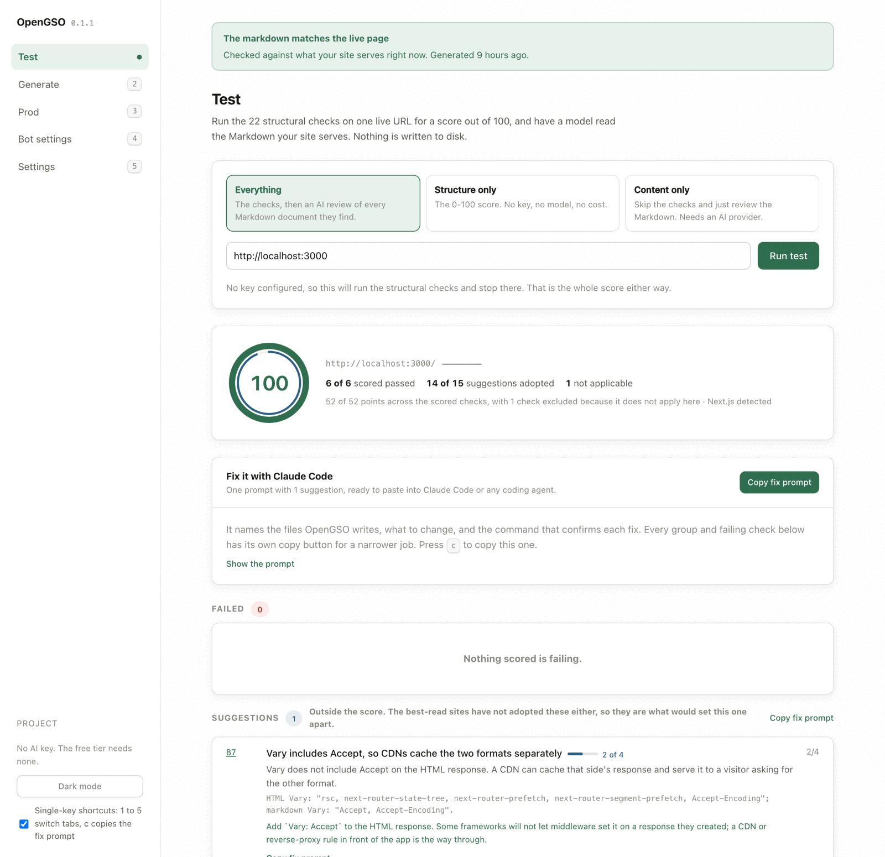
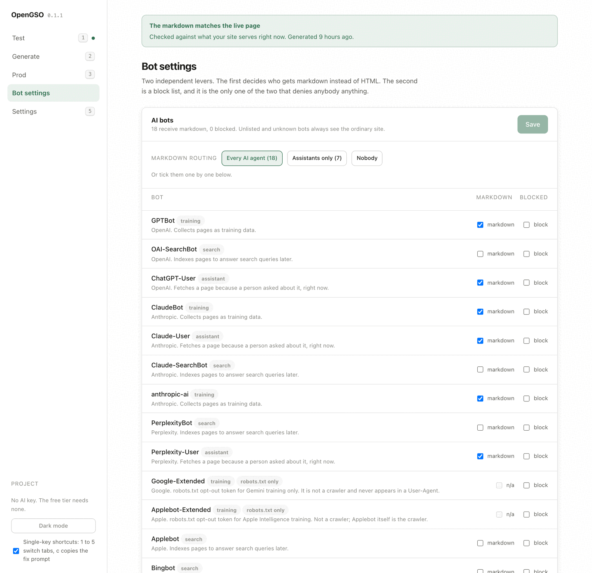

# Open Generative Search Optimization (OpenGSO)

> **Early release.** Until 1.0, a minor release may change a command, a flag, a config field or an export.

Make your website readable by AI agents: score it, write a markdown twin of every page, and serve
the twin at the same URL whenever an agent asks for it.

[](https://www.npmjs.com/package/opengso)
[](https://github.com/sherwinvishesh/OpenGSO/actions/workflows/checks.yml)
[](https://nodejs.org)
[](LICENSE)

ChatGPT, Claude, Perplexity and the crawlers behind them fetch pages the way `curl` does: no
JavaScript runs, and every byte of markup costs tokens. OpenGSO is one toolkit, three commands,
for any framework or static host: **test** scores what an agent receives, **generate** writes the
markdown twins plus `robots.txt`, `llms.txt` and `sitemap.xml`, and **prod** is a zero-dependency
middleware that serves the twin to agents and the page to people.

## Ten seconds: what an agent gets

`GET /resume` on the bundled demo, as ChatGPT or Claude receives it **today**. 13,671 bytes, of
which 10,333 sit inside ten `<script>` tags, and the article is sent twice: once as HTML and once
again inside the framework's payload. Long lines are cut where marked.

```html
<!DOCTYPE html><html lang="en"><head><meta charSet="utf-8"/><meta name="viewport" content="width=device-width, initial-scale=1"/>
<script src="/_next/static/chunks/19mx3mg6lkumu.js" async=""></script>
<script src="/_next/static/chunks/1rj7ns8rte9vc.js" async=""></script>
… three more script tags, the title, the description and the JSON-LD …
<main style="max-width:760px;margin:0 auto;padding:32px 24px 64px"><article><h1>Engagement record</h1><p>Every engagement Aurora Fieldwork has run since 2022, newest first, with its dates, its fee and what came of it. …
<h2>Svalbard permafrost array</h2><p>Commissioned on <strong>3 March 2024</strong> for a fixed fee of <strong>$12,500</strong>. …
… the rest of the article, the footer …
<script>self.__next_f.push([1,"1:\"$Sreact.fragment\"\n2:I[22016,[\"/_next/static/chunks/1mpnoxox0-4cg.js\"],\"\"]\n3:I[39756,
… and the article a second time, as the framework's payload:
[\"$\",\"h2\",null,{\"children\":\"Svalbard permafrost array\"}],[\"$\",\"p\",null,{\"children\":[\"Commissioned on \",
```

The same URL **with OpenGSO**, no redirect. 1,886 bytes, and headers an agent can use.

```http
HTTP/1.1 200 OK
content-type: text/markdown; charset=utf-8
Vary: Accept, Accept-Encoding
x-aeo-version: opengso/1.0
x-markdown-tokens: 432
x-markdown-source-hash: 9e7819e716242848
x-robots-tag: noindex

# Engagement record

Every engagement Aurora Fieldwork has run since 2022, newest first, with its dates, its fee and what came of it. …

## Svalbard permafrost array

Commissioned on **3 March 2024** for a fixed fee of **$12,500**. Fourteen boreholes, instrumented to 6 metres, logging every 15 minutes. …

| Engagement | Start | Fee | Outcome |
| --- | --- | --- | --- |
| Svalbard permafrost array | 3 March 2024 | $12,500 | 42% below data-return target |
…
```

A person in a browser still gets the page, with one header added:
`Link: </resume.md>; rel="alternate"; type="text/markdown"`.

## Sixty seconds: the quickstart

Needs Node.js 22 or later.

```bash
npm install --save-dev opengso
npx opengso test https://your-site.com        # 1. score the site as it is today
npx opengso generate https://your-site.com    # 2. write public/md/*.md, robots.txt, llms.txt, sitemap.xml
```

Then serve the twins. On Next.js 16 that is one file, `proxy.ts`, copied here from the demo (Next
15 calls it `middleware.ts`, exports `middleware`, and adds `runtime: 'nodejs'` to `config`).
Express, Fastify, Koa, Nuxt, Hono, SvelteKit, Astro, React Router, Vite, edge workers and plain
static hosting are in [`opengso-prod`'s README](packages/prod/README.md).

```ts
import { NextResponse } from 'next/server';
import { applyPassthroughHeaders, createNextMiddleware } from 'opengso-prod/next';

const opengso = createNextMiddleware({ root: process.cwd() });

export function proxy(request: Request) {
  const { response, headers } = opengso(request);
  if (response) return response;
  const next = NextResponse.next();
  applyPassthroughHeaders(next, headers);
  return next;
}

export const config = { matcher: ['/((?!_next/static|_next/image|favicon.ico).*)'] };
```

```bash
npx opengso prod test https://your-site.com   # 3. prove the deployment serves them
npx opengso test https://your-site.com        # 4. score it again
```

None of this needs an API key, a browser or an account. `npx opengso` on its own opens a home
screen with your project's last score and a menu of everything there is to do, and
`npx opengso start` opens the same thing as a local dashboard. Generate's free tier, every
structural check and all of `opengso-prod` run offline; a key only buys generate's AI polish tier
and `opengso test --content`, and it stays in `.env` on your machine. There is no telemetry.

## What the test says

Captured from the demo, after the three steps above:

```
$ opengso test http://localhost:3000/resume --structure

OpenGSO test  http://localhost:3000/resume
Detected: Next.js

  100/100  ████████████████████████  6 of 6 scored checks passed, 1 n/a
    ideas  ██████████████████████░░  14 of 15 suggestions adopted
  no change since 4m ago  ████████


Suggestions (1)
---------------
      Conventions for AI agents this page has adopted in part. They are outside
      the score: the best-read sites have not adopted them either, so these are
      what would set this one apart.

  TIP  B7 Vary includes Accept, so CDNs cache the two formats separately  ████░░░░ 2 of 4
      Vary does not include Accept on the HTML response. A CDN can cache that
      side's response and serve it to a visitor asking for the other format.
      HTML Vary: "rsc, next-router-state-tree, next-router-prefetch,
      next-router-segment-prefetch, Accept-Encoding"; markdown Vary: "Accept,
      Accept-Encoding".
      → Add `Vary: Accept` to the HTML response. Some frameworks will not let
        middleware set it on a response they created; a CDN or reverse-proxy
        rule in front of the app is the way through.

Passed (6)
----------
  A1 A3 A5 A6 A7 B13
  Re-run with --verbose to see why each one passed.

Adopted (14)
------------
  A2 A4 B1 B2 B3 B4 B5 B6 B8 B9 B10 B11 B12 B14
  Re-run with --verbose to see why each one passed.

Not applicable (1)
------------------
   n/a A8 Served over HTTPS with HSTS
      Local development target - HTTPS and HSTS are not meaningful here.

  Nothing to fix. Every scored check passed.

  Worth adopting next (suggestions, outside the score)

   tip  B7   Add `Vary: Accept` to the HTML response. Some frameworks will not
             let middleware set it on a response they created; a CDN or
             reverse-proxy rule in front of the app is the way through.

Add --copy to copy a fix prompt for Claude Code, or --prompt to print it.
```

Seven of the 22 checks make the 0 to 100 (crawler access, sitemap, server-rendered content, speed,
no opt-out tag, HTTPS, a working HTML page), so a well-built site scores 100 before installing
anything. The other fifteen are suggestions, counted as "N of 15 adopted" and never in the number:
`llms.txt`, JSON-LD and the markdown layer OpenGSO serves. `--strict` makes an open suggestion fail
CI too, `--content` has a model read the markdown you serve and rate it in a separate section that
never touches the number, and `--copy` puts a fix prompt for Claude Code on your clipboard.
[`opengso-testing`'s README](packages/testing/README.md) has the two passes and the prompt in full.

The dashboard runs the same test, and keeps the copy button next to every failing check:

<picture>
  <source media="(prefers-color-scheme: dark)" srcset="docs/images/dashboard-test-dark.png">
  
</picture>

## Why it works this way

- **Agents do not run JavaScript.** A page that is empty until a script runs is empty to them,
  which is what check A5 measures. Generate extracts the content server-side with jsdom as a
  parser, never a runtime: page scripts are not executed, anywhere.
- **Same URL, rewritten and never redirected.** An agent that asks for `/resume` with
  `Accept: text/markdown`, or with a known AI crawler's User-Agent and no `Accept` at all, gets the
  twin at `/resume`. The `.md` URL works too. A request that accepts neither HTML nor markdown gets
  a 406 rather than a guess.
- **The headers are the contract.** `Vary: Accept` so a CDN caches both formats, `Link rel="alternate"`
  on the HTML so an agent that got the page can find the twin, an `ETag` that answers
  `If-None-Match` with a 304, `X-Markdown-Tokens` so an agent knows the cost before reading, and
  `X-Markdown-Source-Hash` so `opengso test` can tell when the twin no longer matches the live page
  (check B14, the one only the tool that wrote the twin can run).
- **No search engine is ever routed to markdown.** Every markdown response carries
  `X-Robots-Tag: noindex`, so routing Googlebot or Bingbot to it would drop the page from results.
  The default routes the 18 non-search AI crawlers; the search crawlers get HTML, and the config
  refuses a list that routes one.
- **Format and blocking are two levers, kept apart.** Routing never blocks. Blocking is opt-in,
  exists only in the `robots.txt` generate writes, and `opengso-prod` has no blocking code path.
  Unknown bots are never blocked.
- **A production request is a map lookup.** `opengso-prod` has zero dependencies, reads the files
  generate wrote once at boot, and never calls a model or the network.

The whole wire format is in [docs/spec.md](docs/spec.md), written so you could implement it
without OpenGSO.

<picture>
  <source media="(prefers-color-scheme: dark)" srcset="docs/images/dashboard-bots-dark.png">
  
</picture>

## Which package do I install

Install the narrowest one that does what you need. They all expose the same `opengso` command, and
if you ask one for something it does not ship, it tells you which package to install instead.

| Package | Ships | Install it when | npm |
| --- | --- | --- | --- |
| [`opengso`](packages/opengso/README.md) | everything, plus the local dashboard | you want the whole thing, or you want a UI | [npmjs.com/package/opengso](https://www.npmjs.com/package/opengso) |
| [`opengso-cli`](packages/cli/README.md) | `test`, `generate`, `prod test`, `prod data`, `settings` | you want the whole toolchain, terminal only | [npmjs.com/package/opengso-cli](https://www.npmjs.com/package/opengso-cli) |
| [`opengso-testing`](packages/testing/README.md) | `test` | you only want to score a site | [npmjs.com/package/opengso-testing](https://www.npmjs.com/package/opengso-testing) |
| [`opengso-generate`](packages/generate/README.md) | `generate` | you only want the markdown twins and root files | [npmjs.com/package/opengso-generate](https://www.npmjs.com/package/opengso-generate) |
| [`opengso-prod`](packages/prod/README.md) | the middleware, plus `prod test` and `prod data` | this is the one that runs on your server | [npmjs.com/package/opengso-prod](https://www.npmjs.com/package/opengso-prod) |

`opengso-prod` is the package that ends up in a production dependency, so it has **zero
dependencies**, and its library, the part your server imports, has no jsdom and no AI provider
code. `npm run check:bundles` asserts that on every build.

A site that is a folder of HTML files needs no server at all: `opengso generate site --origin
https://your-site.com` writes each twin beside its page, and any static host serves them. See
[From a folder of HTML files](packages/generate/README.md#from-a-folder-of-html-files).

## Bring any AI provider

Only the optional parts take a model. Twenty-five of them out of the box, and the twenty-fifth is
"something else":

```
anthropic  openai  gemini  xai  mistral  deepseek  qwen  kimi  zai  minimax  cohere
perplexity  openrouter  groq  together  fireworks  cerebras  sambanova  deepinfra
huggingface  nvidia  novita  ollama  lmstudio (both on your machine, no key)  custom
```

Type the name you know and it works it out: `--provider claude`, `kwen` or `grok` asks whether you
meant `anthropic`, `qwen` or `xai`. A key you already exported for another tool is picked up as it
is. Anything speaking the OpenAI, Anthropic or Gemini request shape works, including a company
gateway or a self-hosted server, and adding one is three lines of config:
[docs/providers.md](docs/providers.md).

## Docs

- [docs/checks.md](docs/checks.md): all 22 checks, what each verifies, what it is worth, and why.
- [docs/spec.md](docs/spec.md): the `opengso/1.0` wire format: twin URLs, negotiation, headers,
  406 behaviour, frontmatter.
- [docs/config.md](docs/config.md): every field of `opengso.config.json`, with its default.
- [docs/prod-api.md](docs/prod-api.md): every export of `opengso-prod` and its five adapter entries:
  `/next`, `/node`, `/fetch`, `/vite` and `/edge`.
- [docs/providers.md](docs/providers.md): every AI provider OpenGSO ships with, the environment
  variables it already understands, and how to add your own.
- [docs/troubleshooting.md](docs/troubleshooting.md): the problems people hit first, and the fix
  for each.
- [docs/versioning.md](docs/versioning.md): how the `opengso/1.0` spec version relates to the
  package version.
- [docs/architecture.md](docs/architecture.md): for contributors: where the code lives, how it
  reaches the five packages, and what the build enforces.
- [CONTRIBUTING.md](CONTRIBUTING.md), [SECURITY.md](SECURITY.md) and
  [CODE_OF_CONDUCT.md](CODE_OF_CONDUCT.md).
- The website, [sherwinvishesh.github.io/OpenGSO](https://sherwinvishesh.github.io/OpenGSO/), is
  itself generated and served the way this README describes.

## Working on it

The source is plain JavaScript with JSDoc types, so there is no compile step: after `npm install`,
`npm run opengso -- --help` runs the CLI straight from the source tree.

```bash
npm install
npm run typecheck
npm test
npm run build            # packaging only; nothing needs it to run or test the code
npm run check:bundles
npm run check:packages
```

To drive the CLI against the bundled demo, install it globally from its own tarball and use it the
way a user would:

```bash
npm run install:global    # then: opengso --help
npm run example:dev       # serves the demo on localhost:3000
```

See [CONTRIBUTING.md](CONTRIBUTING.md) for the rest, including the one place Changesets cannot
follow a change and what to do about it.

## Known limitations

- **Client-rendered pages.** HTML is parsed with jsdom and page scripts are never executed, so a page
  that is empty until JavaScript runs extracts as empty. Generate still writes its twin, and warns
  with the word count so a near-empty one is never mistaken for the page; on a dev server that renders
  in the browser it says to generate from the production build instead. See
  [`TODO-csr-jsdom.md`](packages/core/src/generate/TODO-csr-jsdom.md).
- **SSR output without semantic landmarks.** Frameworks that ship no `<main>` or `<article>` fall back
  to the whole body. See [`TODO-ssr-extraction.md`](packages/core/src/generate/TODO-ssr-extraction.md).
- **`Vary: Accept` on Next.js App Router.** Next does not let middleware add `Vary` to a response it
  did not create, so an HTML response from an App Router page can lack it. Check B7 scores this as
  a partial, 2 of 4, rather than papering over it. It is the one open suggestion in the report above.
- **CDN behaviour is documented, not claimed.** `Vary: Accept` is set on every markdown response;
  how a given CDN honours it across hosts has not been tested.

## License

Licensed under the [Apache License 2.0](LICENSE).
